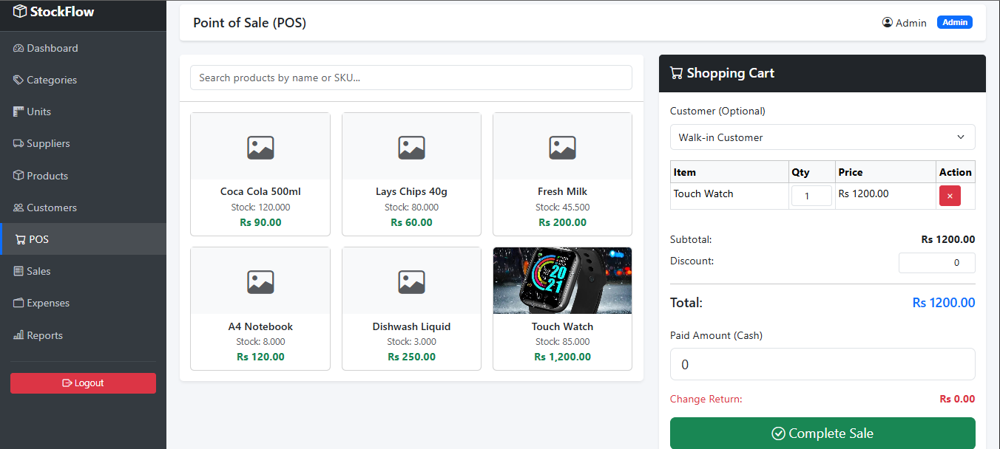
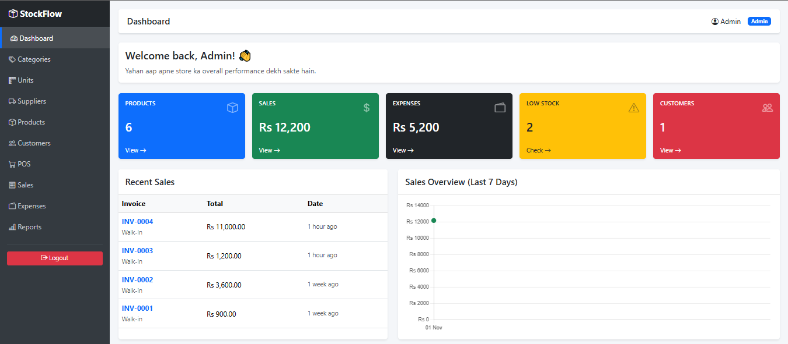
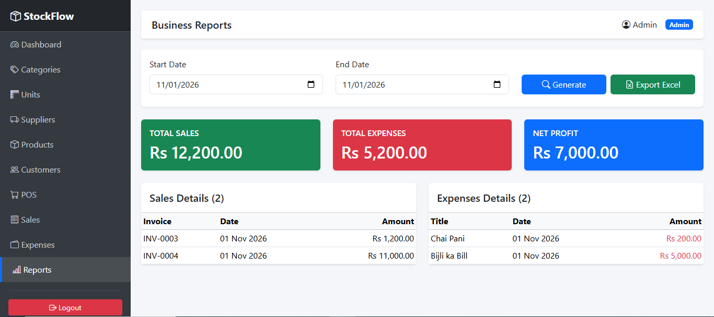

# 🛒 StockFlow POS - Inventory & Point of Sale System

A complete, production-ready Point of Sale and Inventory Management System built with Laravel 11 and Bootstrap 5.


## 📸 Screenshots

### POS Terminal


### Dashboard & Analytics


### Business Reports


---

## 🚀 Key Features

- **Role-Based Access Control (RBAC):** Three distinct roles (Admin, Staff, Cashier) with specific permissions using Spatie Laravel-Permission.
- **Inventory Management:** Full CRUD for Categories, Units, Suppliers, and Products with image uploads.
- **Smart Stock Tracking:** Real-time stock deduction on sales and a dedicated "Stock Movement Ledger" for auditing.
- **Low Stock Alerts:** Visual alerts when product stock falls below the threshold.
- **Point of Sale (POS):** AJAX-powered cart system for fast billing without page reloads.
- **Invoicing & Receipts:** Auto-generated invoice numbers and printable, thermal-printer-friendly receipts.
- **Expense Tracker:** Keep track of daily shop expenses (bills, rent, etc.).
- **Business Reports:** Date-wise Sales, Expenses, and Net Profit calculation with **CSV Export**.

## 🛠️ Tech Stack

- **Backend:** Laravel 11 (PHP 8.2)
- **Database:** MySQL
- **Frontend:** Bootstrap 5, Vanilla JavaScript (AJAX Fetch API)
- **Libraries:** Spatie Laravel-Permission, Chart.js

## ⚙️ Installation & Setup

1. Clone the repository:
   ```bash
   git clone https://github.com/ahmadlashari55/stockflow-pos.git
   cd stockflow-pos